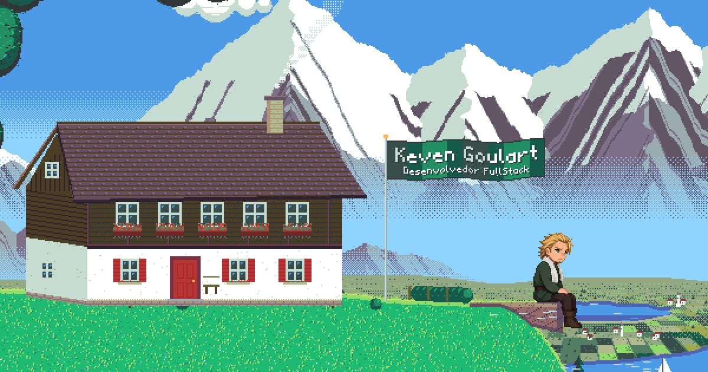

# Keven Goulart · Portfólio

[](https://github.com/KevenGoulart/portfolio/actions/workflows/ci.yml)

**[kezgoulart.dev](https://kezgoulart.dev)** · [versão rápida / currículo](https://kezgoulart.dev/resume)

Meu portfólio é uma caminhada por uma paisagem em pixel art: a rolagem vertical da página move a câmera
de lado por uma vila nos Alpes, e cada seção (sobre mim, projetos, experiência, habilidades e contato)
fica em placas e painéis ao longo da rua. Para quem tem pressa, a página `/resume` mostra o mesmo
conteúdo em uma única coluna, pronta para imprimir.



## Como funciona

- **Renderer próprio em canvas 2D** ([`src/components/journey/renderer.ts`](src/components/journey/renderer.ts)):
  a paisagem é desenhada pixel a pixel em baixa resolução e ampliada para o tamanho da tela, sem
  biblioteca de jogo, em camadas com parallax.
- **Mundo gerado em código** ([`src/components/pixel-landscape`](src/components/pixel-landscape)):
  céu, nuvens, montanhas, lagos e a vila são gerados com ruído determinístico, todos na paleta
  [Resurrect 64](https://lospec.com/palette-list/resurrect-64).
- **Rolagem vertical → caminhada horizontal** ([`journey.tsx`](src/components/journey/journey.tsx)):
  a altura da página é calculada a partir da largura da trilha, e o `scroll` move a câmera e a trilha
  de painéis juntos. Links como `#projects`, foco pelo teclado e gestos laterais do trackpad
  também levam até a seção certa.
- **Acessibilidade**: a paisagem tem descrição para leitores de tela, o conteúdo continua em HTML
  semântico, o foco pelo teclado traz o painel para a tela e `prefers-reduced-motion` é respeitado.
- **Português e inglês** com `next-intl`, escolhidos pelo seletor de idioma.
- **SEO**: metadados e Open Graph por idioma, JSON-LD de `Person`, `sitemap.xml`, `robots.txt` e
  [`llms.txt`](public/llms.txt) para assistentes de IA.

## Stack

Next.js 16 (App Router) · React 18 · TypeScript · Tailwind CSS · next-intl · Motion · ESLint + Prettier ·
GitHub Actions

## Rodando localmente

Pré-requisitos: Node.js 20.9+ e pnpm.

```bash
pnpm install
pnpm dev        # http://localhost:3000
```

| Comando          | O que faz                    |
| ---------------- | ---------------------------- |
| `pnpm dev`       | Servidor de desenvolvimento  |
| `pnpm build`     | Build de produção            |
| `pnpm lint`      | ESLint                       |
| `pnpm typecheck` | Checagem de tipos            |

O CI ([`.github/workflows/ci.yml`](.github/workflows/ci.yml)) roda lint, build e typecheck em cada push
e pull request.

## Estrutura

```
src/
  app/                  layout, página principal, /resume, sitemap e robots
  components/
    journey/            renderer, HUD e peças em pixel art (painel, placa, botão)
    pixel-landscape/    geração do mundo e utilitários de pixel
    sections/           seções do portfólio
  lib/                  dados compartilhados: projetos, experiência, habilidades e contato
messages/               textos em pt-BR e en
```

## Contato

[LinkedIn](https://www.linkedin.com/in/keven-goulart-890248215/) ·
[GitHub](https://github.com/KevenGoulart) · kevengoulartmm@gmail.com
